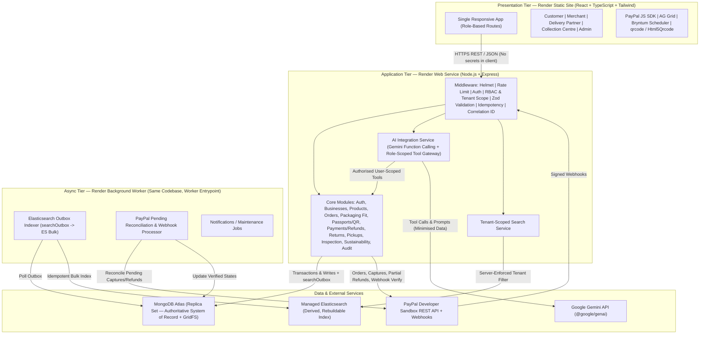

# ReBoxify System Architecture (Blueprint v2.0 Target)

This document defines the target architecture aligning the existing React + TypeScript + Vite repository with **ReBoxify Project Blueprint — Version 2.0**.

---

## 1. High-Level System Architecture



---

## 2. Core Architectural Invariants

1. **MongoDB is the sole system of record.** Elasticsearch is strictly derived from MongoDB via `searchOutbox` and can be wiped and rebuilt from MongoDB at any time. If Elasticsearch is unavailable, core operations continue using MongoDB while search surfaces a degraded-service notice.
2. **Five independent state machines.** `Package`, `Order`, `Return`, `Payment`, and `Pickup` have separate status fields and transition rules. Explicit backend gates link them (e.g., `Order/Package dispatch requires Payment = CAPTURED`; `Return = APPROVED` triggers internal refund eligibility check; `Package cleaning/recirculation` is never blocked by a pending PayPal refund).
3. **Ownership and custody are separate concepts.** Every package records `ownerType` (`SHARED_POOL`, `MERCHANT_OWNED`, `HYBRID`), `ownerId`, and a single active `currentCustodian`. All custody transfers append an immutable event to `packageEvents`.
4. **Deterministic rules decide; Gemini explains and drafts.** Package selection, deposit calculation, return eligibility, inspection decisions, and refund amounts are executed exclusively by deterministic Express services. Gemini reads through a role-scoped Tool Gateway and may only *draft* state-changing requests (`draft_return_request`, `draft_pickup_reschedule`) that the user explicitly confirms via standard APIs.
5. **No secrets in frontend bundles.** `PAYPAL_CLIENT_SECRET`, `PAYPAL_WEBHOOK_ID`, `GEMINI_API_KEY`, `MONGODB_URI`, `ELASTICSEARCH_API_KEY`, `JWT_SECRET`, and `QR_SIGNING_SECRET` reside strictly in backend/worker Render environment variables. Only `PAYPAL_CLIENT_ID` (public) and `VITE_API_BASE_URL` reach the browser.
6. **No direct client refund endpoint.** Refunds are initiated internally by `POST /api/returns/:id/approve` only after backend eligibility checks verify remaining refundable capture balance (`capturedAmount - confirmedRefunds - pendingRefunds`, capped at the package deposit allocation).

---

## 3. Repository & Codebase Layout (Target)

Keeping a unified repository makes deployment on Render (Static Site + Web Service + Background Worker) clean and allows sharing domain TypeScript types/enums if desired:

```text
Reboxify/
├── frontend/                  # Existing React + Vite + TS + Tailwind SPA (migrated from root)
│   ├── src/
│   │   ├── api/               # Typed REST clients (auth, orders, packages, payments, returns, pickups, ai, search, admin)
│   │   ├── components/        # Shared UI, Icons, ThemeToggle, AG Grid wrappers, Bryntum Scheduler wrapper, Gemini Assistant Drawer, QR Passport/Scanner
│   │   ├── contexts/          # AuthContext (JWT/session), ThemeContext
│   │   ├── pages/
│   │   │   ├── LandingPage.tsx
│   │   │   ├── LoginPage.tsx
│   │   │   ├── UserPortal.tsx             # Customer orders, PayPal checkout, passports, return initiation, refund tracking, AI chat
│   │   │   ├── CompanyAdminPortal.tsx     # Merchant Dashboard (10 blueprint areas)
│   │   │   ├── DeliveryPartnerApp.tsx     # Assigned pickups/deliveries, QR scans, evidence, exceptions
│   │   │   ├── CollectionCentrePortal.tsx # NEW: Intake scan, inspection checklist, quarantine/clean/repair queues, AI summary
│   │   │   └── AdminDashboard.tsx         # Network admin: onboarding, pool controls, PayPal reconciliation, ES investigation, audit logs
│   │   └── types/             # Shared domain models & status enums
│   ├── index.html             # Clean Vite HTML (NO importmap, NO cdn.tailwindcss.com)
│   └── tailwind.config.js     # Local Tailwind + PostCSS build
├── backend/                   # NEW: Node.js + Express + Mongoose + Worker
│   ├── src/
│   │   ├── config/            # env validation (zod), db, elasticsearch, paypal, gemini
│   │   ├── middleware/        # auth, rbac, tenantScope, rateLimit, idempotency, validate, errorHandler, correlationId
│   │   ├── models/            # 18 Mongoose schemas + indexes + GridFS helper
│   │   ├── stateMachines/     # Package, Order, Return, Payment, Pickup transition validators
│   │   ├── services/          # 14 modular domain services (see Section 4)
│   │   ├── routes/            # REST API controllers matching Blueprint Section 16.1
│   │   ├── seeds/             # Synthetic hackathon demo seeders (idempotent)
│   │   ├── server.ts          # Express Web Service entrypoint
│   │   └── worker.ts          # Background Worker entrypoint (outbox indexer + PayPal reconciliation)
│   ├── tests/                 # Unit, state-machine, fit-engine, PayPal/webhook & failure-simulation tests
│   └── package.json
├── render.yaml                # Render Blueprint: Static Site + Web Service + Background Worker
└── package.json               # Root workspace scripts (dev, build, test)
```

---

## 4. Modular Backend Services (14 Modules)

1. **Authentication & RBAC (`authService`)**: Password hashing (`bcryptjs` or `argon2`), JWT signing/verification (or HTTP-only cookie + CSRF), 6 roles (`CUSTOMER`, `MERCHANT_ADMIN`, `MERCHANT_STAFF`, `DELIVERY_PARTNER`, `COLLECTION_CENTRE`, `ADMIN`), tenant (`businessId`) binding, rate-limited auth endpoints.
2. **Merchant & Business Management (`businessService`)**: Business onboarding, legal/settings profile, currency configuration, packaging ownership policy (`SHARED_POOL`, `MERCHANT_OWNED`, `HYBRID`), return/deposit policy rules, staff management.
3. **Product & Order Management (`productService`, `orderService`)**: SKU catalogue (`merchantId`, `sku`, `dimensionsCm`, `weightKg`, `allowedOrientations`, `rotatable`, `fragility`, `restrictions`), order creation, item validation, itemised totals (`subtotal`, `depositTotal`, `shipping`, `tax`, `currency`).
4. **Packaging Catalogue & Deterministic Allocation Engine (`packagingService`, `allocationEngine`)**:
   - Standard rigid PP classes: `S` (20×15×10 cm), `M` (30×25×15 cm), `L` (45×35×25 cm), `XL` (60×45×35 cm) with configurable weight limits, protection category, and replacement value.
   - 8-step deterministic engine: validate SKU dimensions (reject/ask if missing, never guess from images) -> generate allowed 3D orientations -> check internal clearance with padding -> check weight limit & protection -> filter available inventory at fulfilment location respecting ownership/cross-merchant permissions -> score candidates -> select smallest compliant package (or single-package simple stacking / split-shipment recommendation for MVP).
5. **Digital Passport & QR Services (`passportService`, `qrService`)**: Unguessable package IDs (e.g., `RBX-CHN-000104` + random/HMAC QR verification token with zero PII in QR payload), `qrcode` label generation, operator-verified label reprint, authorised scan verification (`POST /api/packages/:packageId/scan`) rejecting invalid state transitions and replayed scans, append-only `packageEvents` writer.
6. **Payment & Refund Management (`paymentService`, `paypalClient`, `webhookService`)**: PayPal REST API v2 client (`POST /v2/checkout/orders`, `POST /v2/checkout/orders/{id}/capture`, `POST /v2/payments/captures/{capture_id}/refund` with unique `PayPal-Request-Id`, `GET /v2/checkout/orders/{id}` & `GET /v2/payments/refunds/{id}` reconciliation, `POST /v1/notifications/verify-webhook-signature`). Per-package deposit allocation in `transactions`, cumulative refundable balance reservation (`pendingRefundAmount`), deduplication in `webhookEvents`, idempotency in `idempotencyKeys`, and `POST /api/webhooks/paypal` cryptographic verification + reconciliation.
7. **Return Management, Evidence & Deterministic Refunds (`returnService`, `refundCalculation`, `evidenceStorage`)**: Customer/merchant-on-behalf return initiation (`PICKUP`, `DROP_OFF`, `NEXT_DELIVERY_SWAP`), deadline & late-return tracking, duplicate return prevention, partner assignment, QR-authorised collection & collection-centre intake, private photo evidence upload/download via MongoDB GridFS (`returnEvidence` bucket, validated MIME + magic bytes, max 5 MB), structured 4-point inspection & condition grading (`GOOD`, `MINOR_WEAR`, `MINOR_DAMAGE`, `MAJOR_DAMAGE`, `CONTAMINATED`, `MISSING_PACKAGING`, `UNUSABLE`, `WRONG_PACKAGE`), server-side deterministic partial/full/zero refund calculation (`calculateReturnRefund`), role separation (`SELF_INSPECTION_FORBIDDEN` / `SELF_APPROVAL_FORBIDDEN`), Gate 3 cleaning/recirculation independence, and atomic refund reservation -> PayPal execution -> failure retry (`POST /api/returns/:id/reconcile-refund`).
8. **Pickup Scheduling (`pickupService`)**: Slot publication, delivery partner capacity/working-hours/service-zone validation, collection-centre capacity checks, Bryntum Scheduler timeline feed (`GET /api/pickups`), atomic partner assignment & rescheduling (`PATCH /api/pickups/:id`) with optimistic concurrency / conflict reporting, missed-pickup rescheduling without penalising customers.
9. **Inspection & Recirculation (`inspectionService`)**: Collection-centre workflow (`AT_CENTRE` -> `INSPECTED` -> `QUARANTINED` / `CLEANING` / `REPAIR` -> `AVAILABLE` or `RETIRED`), lifecycle-limit quarantine check, contamination quarantine, and incrementing `reuseCount + 1` **only** upon passing inspection and release.
10. **AI Integration Service (`aiService`, `toolGateway`, `promptTemplates`)**: `@google/genai` integration with Gemini function calling. Injects verified `userId`, `role`, and `businessId` from session (never from model). Strict tool allow-list & Zod argument validation for 9 tools (`get_order_status`, `get_passport_summary`, `get_return_status`, `get_refund_status` / `get_pickup_status`, `recommend_packaging`, `search_events`, `get_merchant_metrics`, `draft_return_request`, `draft_pickup_reschedule`). Validates output against backend records, labels answers as AI, logs every call in `aiInteractions`, and falls back to deterministic templates if Gemini is unavailable.
11. **Search & Event Services (`outboxService`, `searchService`)**: Writes `searchOutbox` record inside the same MongoDB transaction as entity mutations. Express search endpoints (`/api/search/passports`, `/events`, `/returns`) apply server-side `merchantId`/`customerId` filters before querying Elasticsearch, and re-verify records in MongoDB before actions.
12. **Sustainability Reporting (`sustainabilityService`)**: Computes verified reuse cycles, average cycles/package, return/damage/loss rates, turnaround time, avoided single-use instances (only when baseline qualifies), material mass avoided, and net emissions (`avoided single-use - reusable lifecycle - reverse logistics`) with methodology/assumptions/uncertainty metadata.
13. **Audit Logging (`auditService`)**: Records `actor`, `action`, `entity`, `before`/`after` summary, `timestamp`, and `correlationId` for sensitive operations (refunds, inspections, ownership changes, AI-confirmed actions, admin overrides).
14. **Background Workers (`worker.ts`)**: Polls `searchOutbox` for idempotent Elasticsearch bulk indexing (`passports`, `package-events`, `returns`, `payments`), processes queued webhook jobs, runs scheduled PayPal reconciliation for `CAPTURE_PENDING` / `REFUND_PENDING` records beyond configured age, and provides a CLI rebuild command for Elasticsearch.

---

## 5. Five Independent State Machines

| Entity | States (Blueprint Section 15.2 & 10.5) |
| :--- | :--- |
| **Package** | `AVAILABLE` -> `RESERVED` -> `PACKED` -> `DISPATCHED` -> `WITH_CUSTOMER` -> `RETURN_REQUESTED` -> `COLLECTED` -> `AT_CENTRE` -> `INSPECTED` -> (`CLEANING` / `REPAIR` / `QUARANTINED` / `UNDER_INVESTIGATION`) -> `AVAILABLE` (`reuseCount + 1`) or `RETIRED` |
| **Order** | `PLACED` -> `PAYMENT_PENDING` -> `PAID` -> `ALLOCATED` -> `DISPATCHED` -> `DELIVERED` / `CANCELLED` |
| **Return** | `REQUESTED` -> (`PICKUP_SCHEDULED` \| `DROP_OFF_SELECTED`) -> `COLLECTED` -> `RECEIVED` -> `UNDER_INSPECTION` -> (`APPROVED` \| `REJECTED` \| `NEEDS_REVIEW`) -> `CLOSED` |
| **Payment** | `CREATED` -> `APPROVED` -> `CAPTURE_PENDING` -> `CAPTURED` -> `REFUND_REQUESTED` -> `REFUND_PENDING` -> (`PARTIALLY_REFUNDED` \| `REFUNDED`), plus `CAPTURE_FAILED`, `REFUND_FAILED`, `REVERSED`, `DISPUTED` |
| **Pickup** | `UNASSIGNED` -> `ASSIGNED` -> `IN_PROGRESS` -> (`COMPLETED` \| `MISSED`) -> `RESCHEDULED` / `CANCELLED` |

---

## 6. MongoDB Collections (18 Collections from Section 15.1)

1. `users` (`email` unique, `role`, `status`, `businessId`, `passwordHash`)
2. `businesses` (`ownerUserId`, profile, `currency`, `packagingModel`, `policies`, `subscription`)
3. `products` (unique compound `(merchantId, sku)`, dimensions, weight, orientations, fragility, restrictions)
4. `packages` (unique `packageId`, `qrTokenHash`, `ownerId`, `ownerType`, `class`, `dimensions`, `material`, `replacementValue`, `status`, `reuseCount`, `currentCustodian`, `currentOrderId`)
5. `orders` (`merchantId`, `customerId`, `items`, `allocatedPackages`, `totals`, `currency`, `status`)
6. `transactions` (`orderId`, unique `paypalOrderId`, unique sparse `captureId`, `amount`, `currency`, `state`, `depositAllocations[]`)
7. `refunds` (`transactionId`, `returnId`, `packageId`, unique sparse `providerRefundId`, `amount`, `reason`, `state`, unique `idempotencyKey`)
8. `returns` (`orderId`, `packageId`, `customerId`, `mode`, `pickupId`/`centreId`, `inspection`, `decision`, `refundEligibility`)
9. `pickups` (`returnId`, `packageId`, `slotStart`, `slotEnd`, `partnerId`, `status`, `rescheduleHistory[]`, `missedReason`, `version`)
10. `deliveryPartners` (`userId`, `serviceZones[]`, `workingHours`, `dailyCapacity`, `status`)
11. `packageEvents` (append-only: unique `eventId`, `packageId`, partial unique `(packageId, scanId)` with `partialFilterExpression: { scanId: { $exists: true } }`, `type`, `actor`, `occurredAt`, `correlationId`, `evidence[]`, `outcome`)
12. `collectionCenters` (`operatorUserId`, `address`, `hours`, `capacity`, `currentWorkload`)
13. `webhookEvents` (unique `providerEventId`, `eventType`, `payloadSummary`, `verificationResult`, `processingState`)
14. `idempotencyKeys` (unique `key`, `operation`, `requestHash`, `resultRef`, `expiresAt` TTL)
15. `aiInteractions` (`userId`, `role`, `intent`, `toolCalls[]`, `resultRefs[]`, `model`, `promptVersion`, `outcome`, `flagged`)
16. `searchOutbox` (`entityType`, `entityId`, `operation`, `attempts`, `status`, `nextRetryAt`)
17. `greenWallets` (`userId`, `balance`, `ledger[]` — schema reserved, **Post-MVP**)
18. `auditLogs` (`actor`, `action`, `entityType`, `entityId`, `before`, `after`, `timestamp`, `correlationId`)

---

## 7. Backend REST API Surface (Blueprint Section 16.1)

- **Health:** `GET /api/health`
- **Auth & Setup:** `POST /api/auth/register`, `POST /api/auth/login`, `POST /api/auth/logout`, `GET /api/auth/me`, `POST /api/businesses`, `POST /api/products` (+ `GET /api/products`)
- **Inventory, Orders & Packaging:** `GET /api/inventory` (AG Grid server pagination/filter/sort), `POST /api/orders`, `GET /api/orders`, `POST /api/orders/:id/allocate-package`
- **Payments & Webhooks:** `POST /api/payments/paypal/create-order`, `POST /api/payments/paypal/capture/:id`, `POST /api/webhooks/paypal`, `GET /api/payments/:id`, `GET /api/transactions`
- **Passports & Scans:** `GET /api/packages/:packageId/passport`, `POST /api/packages/:packageId/scan`
- **Returns, Evidence, Inspection & Refunds:** `POST /api/returns`, `GET /api/returns`, `GET /api/returns/:id`, `GET /api/returns/:id/refund`, `POST /api/returns/:id/assign-partner`, `POST /api/returns/:id/collect`, `POST /api/returns/:id/receive`, `POST /api/returns/:id/evidence`, `GET /api/returns/:id/evidence/:fileId`, `POST /api/returns/:id/inspect`, `POST /api/returns/:id/approve`, `POST /api/returns/:id/reject`, `POST /api/returns/:id/reconcile-refund` (+ Phase 4 QR scan transitions for `CLEANING` / `REPAIR` / `QUARANTINED` -> `AVAILABLE`)
- **Pickups (Bryntum):** `GET /api/pickups`, `POST /api/pickups`, `PATCH /api/pickups/:id`
- **Search (Elasticsearch):** `GET /api/search/passports`, `GET /api/search/events`, `GET /api/search/returns`
- **Gemini AI:** `POST /api/ai/assistant/chat`, `POST /api/ai/actions/:id/confirm`, `POST /api/ai/packaging/explain`, `POST /api/ai/returns/:id/summary`, `POST /api/ai/insights/merchant-report`
- **Sustainability & Governance:** `GET /api/sustainability/summary`, `GET /api/audit-logs`, `POST /api/admin/reconcile-payments`

---

## 8. Explicit External Marketplace Integration Boundary

Per Blueprint Section 25.2, **Phase 1 (Hackathon MVP)** owns the ReBoxify storefront/order API, itemised checkout, PayPal Sandbox capture, returns, and partial refunds. Future phases (WooCommerce/Shopify in Phase 2, Amazon/Flipkart Seller APIs in Phase 3, ERP/WMS in Phase 4) are **Post-MVP** and subject to strict platform boundaries: third-party marketplace APIs do **not** allow arbitrary modification of marketplace checkout, addition of separate customer deposits, or interception of marketplace refunds without explicit platform approval.

